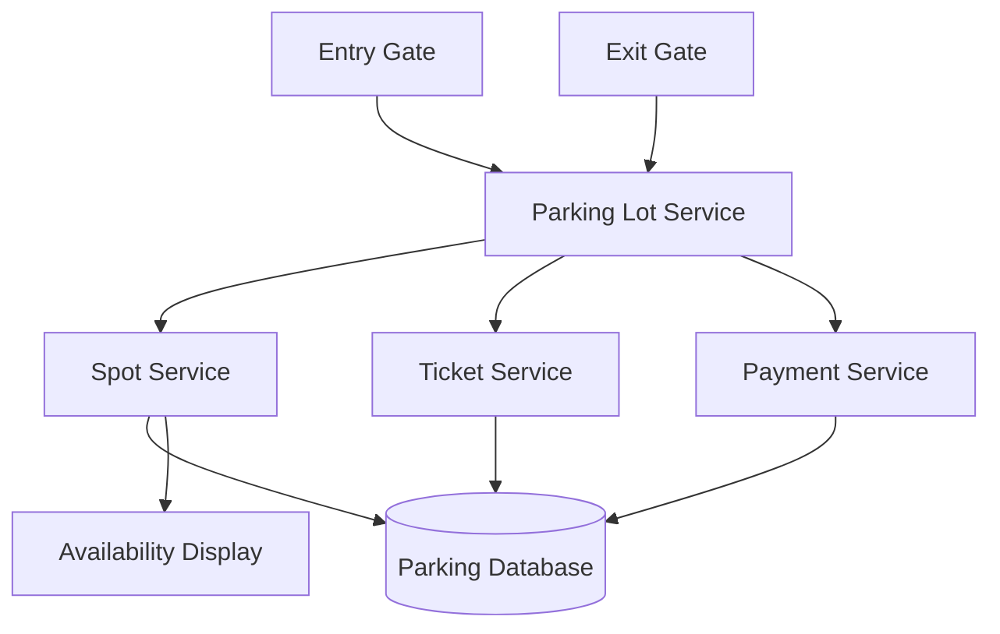

A parking lot system manages parking spaces, tracks the vehicles that are parked and calculates the fees when the vehicle leaves. The design can support a small parking garage or multiple floors with different vehicle and spot types.

A parking lot can have multiple floors, entry and exit gates, different parking spot types, parking tickets, payment machines or payment at the exit gate, and electronic displays showing available spaces.

For example, a motorcycle should be assigned a bug-sized spot if smaller spots are available.

# REQUIREMENTS

## FUNCTIONAL REQUIREMENTS

The system should allow us to -

    1. Park a vehicle in an available spot
    2. Issue a ticket when a vehicle enters
    3. Find an available spot suitable for the vehicle
    4. Process payment when the vehicle leaves
    5. Free the spot after the vehicle leaves
    6. Show the available spots by floor and vehicle type

## NON-FUNCTIONAL REQUIREMENTS

The system should have -

    1. Reliable entry and exit processing
    2. Accurate availability counts
    3. Low wait times at entry and exit gates
    4. Support for multiple floors and entry/exit gages
    5. Protection against assigning the same spot to two vehicles
    6. Spot availability checks and nearest-slot allocations should execute with minimal delay

# BASIC FLOW

The basic flow when the vehicle enters a parking lot is -

    1. The entry gate identifies the vehicle type.
    2. The system finds a suitable available spot.
    3. The spot is marked as occupied.
    4. A ticket is created and given to the driver.

When exiting -

    1. The ticket is scanned.
    2. The system calculates the parking fee.
    3. The driver pays.
    4. The spot is marked as available.
    5. The gate opens.

    Entry Gate -> Find Spot -> Create Ticket -> Park Vehicle

    Exit Gate -> Scan Ticket -> Calculate Fee -> Take Payment -> Free Spot

A spot can have a type like motorcycle, compact, large, or accessible. The system should choose a spot based on -

    1. Vehicle type
    2. Spot availability
    3. Floor or Zone preference
    4. Distance from entry, if relevant

For a simple design, keep available spots grouped by type. When a vehicle enters, the system can find a suitable spot without scanning every spot.

# DATA MODEL

In our database, we can keep a few tables to store relevant information.

For Parking Spots, we can have a table -

    parking_spot
    -----------
    spot_id
    floor_id
    spot_type
    status

For tickets, we can have another table -

    ticket
    ------
    ticket_id
    vehicle_id
    spot_id
    entry_time
    exit_time
    status

For vehicles we can have a table too -

    vehicle
    -------
    vehicle_id
    license_plate
    vehicle_type

Finally, a table can be there for payments -

    payment
    -------
    payment_id
    ticket_id
    amount
    paid_at
    status

The ticket connects a vehicle to its parking spot and records when the parking session began and when it ended.

# AVOIDING DOUBLE ASSIGNMENT

Let's say that our parking lot has multiple entry gates, so each entry gate has the same parking lot system.

Suppose two vehicles arrive at different gates at the same time. Both gates may see the same spot as available and try to assign it.

The system should claim the spot with an atomic database update:

    UPDATE parking_spot
    SET status = 'OCCUPIED'
    WHERE spot_id = 42 AND status = 'AVAILABLE';

The database reports how many rows were updated.

    - If one row was updated, this request claimed the spot.
    - If zero rows were updated, another request already claimed it, so the system tries another spot.

Creating the ticket and claiming the spot should happen in the same database transaction. If ticket creation fails, the spot claim is rolled back.

This makes the database the final authority on whether a spot is available; the display or cached availability count may briefly be stale.

# FEE CALCULATION

The fees can depend on -

    1. Parking duration
    2. Vehicle type
    3. Time of the day
    4. Flat rate or hourly rate

For example, the system can charge a minimum fee for the first house and then an additional amount for each extra house.

# FINAL DESIGN

The core of a parking lot system is assigning a suitable spot, creating a ticket, and releasing the spot after payment. Spot assignment must be atomic so two vehicles cannot be assigned the same space.