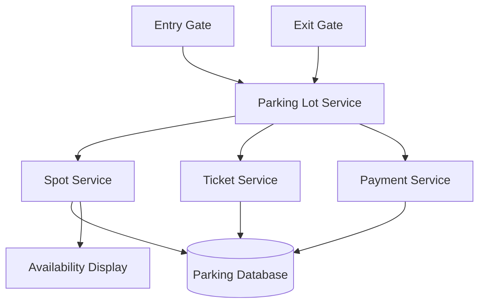

A parking lot system manages parking spaces, tracks the vehicles that are parked and calculates the fees when the vehicle leaves. The design can support a small parking garage or multiple floors with different vehicle and spot types.

A parking lot can have multiple floors, entry and exit gates, different parking spot types, parking tickets, payment machines or payment at the exit gate, and electronic displays showing available spaces.

For example, a motorcycle should be assigned a bug-sized spot if smaller spots are available.

# 1. REQUIREMENTS

## FUNCTIONAL REQUIREMENTS

Core requirements (about 3) -

    1. When a vehicle enters, find a suitable available spot and issue a ticket
    2. When a vehicle exits, calculate the fee, take the payment and free the spot
    3. Show the available spots by floor and vehicle type

Below the line -

    1. Reservations in advance
    2. Monthly passes
    3. Finding the nearest spot to a specific entrance

## NON-FUNCTIONAL REQUIREMENTS

    1. Strong consistency when claiming a spot. The same spot must never be assigned to two vehicles
    2. Reliable entry and exit processing with low wait times at the gates
    3. Support for multiple floors and multiple entry and exit gates
    4. Availability counts on displays can be briefly stale (eventual consistency is fine)

# 2. CORE ENTITIES

    1. Vehicle
    2. Parking Spot (with a type and a floor)
    3. Ticket (links a vehicle to a spot for one parking session)
    4. Payment

# 3. API DESIGN

    POST /tickets                       { vehicle_type, license_plate, gate_id }
                                        -> { ticket_id, spot_id, entry_time }

    POST /tickets/{ticket_id}/exit      -> { fee, payment_status }  (calculates the fee and takes the payment)

    GET  /availability?floor={floor}&vehicle_type={type}
                                        -> { available_spots }

# 4. DATA FLOW (ENTRY AND EXIT)

The basic flow when the vehicle enters a parking lot is -

    1. The entry gate identifies the vehicle type.
    2. The system finds a suitable available spot.
    3. The spot is marked as occupied.
    4. A ticket is created and given to the driver.

When exiting -

    1. The ticket is scanned.
    2. The system calculates the parking fee.
    3. The driver pays.
    4. The spot is marked as available.
    5. The gate opens.

    Entry Gate -> Find Spot -> Create Ticket -> Park Vehicle

    Exit Gate -> Scan Ticket -> Calculate Fee -> Take Payment -> Free Spot

A spot can have a type like motorcycle, compact, large, or accessible. The system should choose a spot based on -

    1. Vehicle type
    2. Spot availability
    3. Floor or Zone preference
    4. Distance from entry, if relevant

For a simple design, keep available spots grouped by type. When a vehicle enters, the system can find a suitable spot without scanning every spot.

# 5. HIGH-LEVEL DESIGN

The gates talk to a parking lot service. It uses a spot service to assign spots, a ticket service to create tickets and a payment service for fees. A single database is the source of truth.

## DATA MODEL

In our database, we can keep a few tables to store relevant information.

For Parking Spots, we can have a table -

    parking_spot
    -----------
    spot_id
    floor_id
    spot_type
    status

For tickets, we can have another table -

    ticket
    ------
    ticket_id
    vehicle_id
    spot_id
    entry_time
    exit_time
    status

For vehicles we can have a table too -

    vehicle
    -------
    vehicle_id
    license_plate
    vehicle_type

Finally, a table can be there for payments -

    payment
    -------
    payment_id
    ticket_id
    amount
    paid_at
    status

The ticket connects a vehicle to its parking spot and records when the parking session began and when it ended.

# 6. DEEP DIVES

Deep dives are where we harden the design against the non-functional requirements, fix edge cases and remove bottlenecks. As a senior candidate, we should lead these discussions ourselves instead of waiting for the interviewer to point at weaknesses. Each deep dive below is tied to a requirement or a risk.

## DEEP DIVE 1: AVOIDING DOUBLE ASSIGNMENT

Let's say that our parking lot has multiple entry gates, so each entry gate has the same parking lot system.

Suppose two vehicles arrive at different gates at the same time. Both gates may see the same spot as available and try to assign it.

The system should claim the spot with an atomic database update:

    UPDATE parking_spot
    SET status = 'OCCUPIED'
    WHERE spot_id = 42 AND status = 'AVAILABLE';

The database reports how many rows were updated.

    - If one row was updated, this request claimed the spot.
    - If zero rows were updated, another request already claimed it, so the system tries another spot.

Creating the ticket and claiming the spot should happen in the same database transaction. If ticket creation fails, the spot claim is rolled back.

This makes the database the final authority on whether a spot is available; the display or cached availability count may briefly be stale.

## DEEP DIVE 2: FEE CALCULATION

The fees can depend on -

    1. Parking duration
    2. Vehicle type
    3. Time of the day
    4. Flat rate or hourly rate

For example, the system can charge a minimum fee for the first house and then an additional amount for each extra house.

# SUMMARY

The core of a parking lot system is assigning a suitable spot, creating a ticket, and releasing the spot after payment. Spot assignment must be atomic so two vehicles cannot be assigned the same space.

# DELIVERY FRAMEWORK CHEAT SHEET FOR THIS QUESTION

    1. Requirements (5 min) - enter and ticket, exit and pay, availability display. No double assignment.
    2. Core entities (2 min) - Vehicle, Spot, Ticket, Payment.
    3. API (5 min) - POST /tickets, POST /tickets/{id}/exit, GET /availability.
    4. Data flow - the entry and exit sequence.
    5. High-level design (10-15 min) - lot service with spot, ticket and payment services over one database.
    6. Deep dives (10 min) - atomic spot claim in a transaction, pricing rules.
