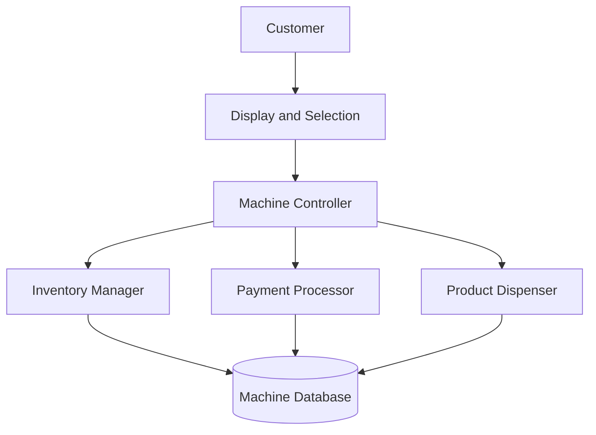

A vending machine lets customers select and buy products without a cashier.

The system needs to track products, accept payments, dispense the selected product, and handle cases like insufficient payment or an out-of-stock item.

The basic flow when a customer buys a product is -

    1. The machine checks that the product is available
    2. It reserves one unit so it cannot be sold twice
    3. The customer pays
    4. The machine dispenses the product
    5. The inventory is updated and the transaction is complete

    Select Product -> Check Inventory -> Pay -> Dispense Product -> Complete Purchase

If the payment failed, the product reservation is released.

If the payment succeeds but the product cannot be dispensed, the machine should refund the customer or mark the transaction for recovery.

The main components of a vending machine are - 

    1. Display and Selection Interface
    2. Payment Processor
    3. Inventory Manager
    4. Product Dispenser
    5. Transaction Manager
    6. Machine Controller

The Machine Controller co-ordinates the purchase. It communicates with the payment processor, inventory manager, and dispenser.

# REQUIREMENTS

## 1. FUNCTIONAL REQUIREMENTS

The system should allow a user to -

    1. View available products and their prices
    2. Select a product
    3. Pay using cash, card, UPI or other supported method
    4. Receive the selected product
    5. Receive the change or refund if needed

And operator should be able to refill the products, update the prices, and check the inventory.

## 2. NON-FUNCTIONAL REQUIREMENTS

The system should have -

    1. Reliable payment and product dispensing
    2. Accurate inventory tracking
    3. Safe handling of failed purchases
    4. Low response times for product selection and payment
    5. A way to detect and report the machine failure

# DATA MODEL

In our vending machine system, we can have some tables to store information.

For the products, we can have a 'product' table -

    Product
    -------
    product_id
    name
    price

For the inventory, we can have the 'inventory' table -

    Inventory
    ---------
    slot_id
    product_id
    quantity

Here, product_id corresponds to a product in the 'product' table.

We can keep a 'transaction' table with transaction records where each record helps the system recover if the payment or dispensing failed partway through the payment -

    Transaction
    -----------
    transaction_id
    product_id
    amount
    payment_status
    dispense_status
    created_at

## HANDLING CONCURRENT DISPENSING

Payment and physical dispensing cannot usually happen in one database transaction. The system should track each step with a transaction status like -

    PENDING -> PAID -> DISPENSED -> COMPLETED

If the machine loses power after the payment, it can inspect unfinished transactions when it starts again and decide whether to dispense the product or refund the customer.

# FINAL DESIGN

The machine should reserve inventory before completing a purchase and track payment and dispensing as separate steps.

This helps prevent selling the last item twice and gives the system a way to recover from failures between payment and dispensing.