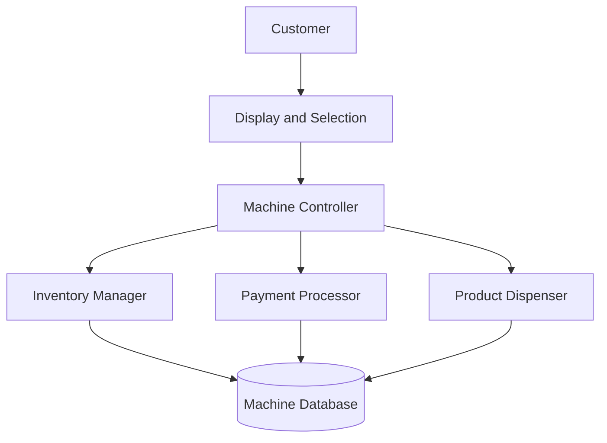

A vending machine lets customers select and buy products without a cashier.

The system needs to track products, accept payments, dispense the selected product, and handle cases like insufficient payment or an out-of-stock item.

# 1. REQUIREMENTS

## FUNCTIONAL REQUIREMENTS

Core requirements (about 3) -

    1. A customer can view the available products and prices and select a product
    2. A customer can pay (cash, card, UPI or another method) and receive the product, plus change or a refund if needed
    3. An operator can refill products, update prices and check the inventory

## NON-FUNCTIONAL REQUIREMENTS

    1. Reliable payment and dispensing. The customer is never charged without getting the product or a refund
    2. Accurate inventory. The last item must not be sold twice
    3. Safe recovery when something fails partway, for example a power loss after payment
    4. Low response time for selection and payment
    5. A way to detect and report machine failures

# 2. CORE ENTITIES

    1. Product
    2. Inventory (a slot and the quantity of a product in it)
    3. Transaction (one purchase, with payment and dispense status)
    4. Operator

# 3. API DESIGN

This is a single machine, so the interface is the set of operations that the Machine Controller exposes.

    Customer
        selectProduct(product_id)
        pay(method, amount)
        cancel()                      // releases the reservation and refunds

    Operator
        refill(slot_id, quantity)
        updatePrice(product_id, price)
        getInventory()

# 4. DATA FLOW

The basic flow when a customer buys a product is -

    1. The machine checks that the product is available
    2. It reserves one unit so it cannot be sold twice
    3. The customer pays
    4. The machine dispenses the product
    5. The inventory is updated and the transaction is complete

    Select Product -> Check Inventory -> Pay -> Dispense Product -> Complete Purchase

If the payment failed, the product reservation is released.

If the payment succeeds but the product cannot be dispensed, the machine should refund the customer or mark the transaction for recovery.

# 5. HIGH-LEVEL DESIGN

The main components of a vending machine are - 

    1. Display and Selection Interface
    2. Payment Processor
    3. Inventory Manager
    4. Product Dispenser
    5. Transaction Manager
    6. Machine Controller

The Machine Controller co-ordinates the purchase. It communicates with the payment processor, inventory manager, and dispenser.

## DATA MODEL

In our vending machine system, we can have some tables to store information.

For the products, we can have a 'product' table -

    Product
    -------
    product_id
    name
    price

For the inventory, we can have the 'inventory' table -

    Inventory
    ---------
    slot_id
    product_id
    quantity

Here, product_id corresponds to a product in the 'product' table.

We can keep a 'transaction' table with transaction records where each record helps the system recover if the payment or dispensing failed partway through the payment -

    Transaction
    -----------
    transaction_id
    product_id
    amount
    payment_status
    dispense_status
    created_at

# 6. DEEP DIVES

Deep dives are where we harden the design against the non-functional requirements, fix edge cases and remove bottlenecks. As a senior candidate, we should lead these discussions ourselves instead of waiting for the interviewer to point at weaknesses. Each deep dive below is tied to a requirement or a risk.

## DEEP DIVE 1: PAYMENT AND DISPENSING ARE SEPARATE STEPS

Payment and physical dispensing cannot usually happen in one database transaction. The system should track each step with a transaction status like -

    PENDING -> PAID -> DISPENSED -> COMPLETED

If the machine loses power after the payment, it can inspect unfinished transactions when it starts again and decide whether to dispense the product or refund the customer.

## DEEP DIVE 2: RESERVING THE LAST ITEM

To stop an item from being sold twice, we reserve one unit when the customer selects it, before taking the payment. The reservation should be one atomic update -

    UPDATE inventory
    SET quantity = quantity - 1
    WHERE slot_id = 5 AND quantity > 0;

If one row was updated, the item is reserved. If no row was updated, the item is out of stock. If the payment fails or the customer cancels, the quantity is added back.

# SUMMARY

The machine should reserve inventory before completing a purchase and track payment and dispensing as separate steps.

This helps prevent selling the last item twice and gives the system a way to recover from failures between payment and dispensing.

# DELIVERY FRAMEWORK CHEAT SHEET FOR THIS QUESTION

    1. Requirements (5 min) - select, pay and receive, operator refill. No charge without a product.
    2. Core entities (2 min) - Product, Inventory, Transaction.
    3. API (5 min) - controller operations for the customer and the operator.
    4. Data flow - select, reserve, pay, dispense, complete (with release or refund on failure).
    5. High-level design (10-15 min) - controller with inventory, payment and dispenser over one database.
    6. Deep dives (10 min) - transaction states for crash recovery, atomic reservation of stock.
