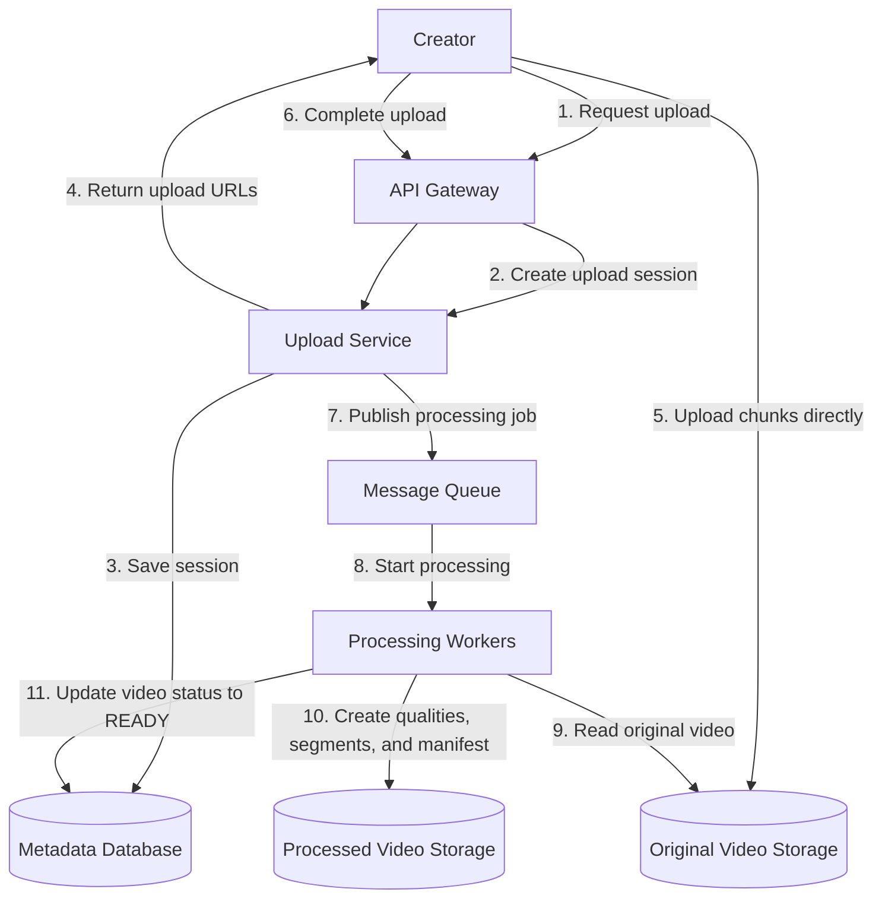
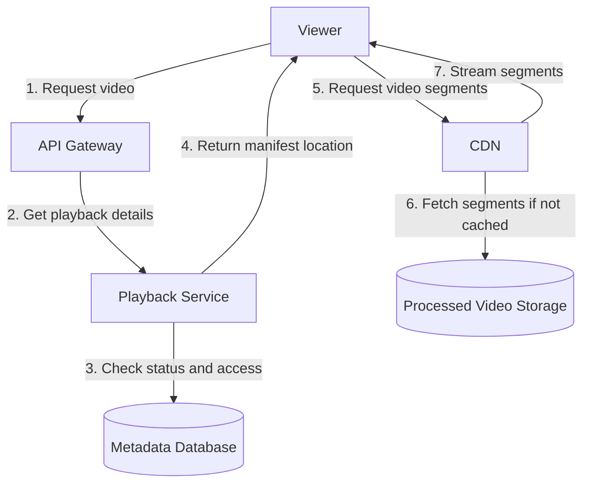

A video streaming platform lets the creators upload videos and viewers watch them on demand.

Such a system needs to handle large video uploads, create versions for different devices and network speeds, and deliver video smoothly to the viewers around the world.

# REQUIREMENTS

## 1. FUNCTIONAL REQUIREMENTS

The users should be able to -

    1. Upload, view, search for, and delete the videos
    2. Watch, pause, seek, and change the video quality
    3. Like videos, comment, and subscribe to the channels
    4. View the video details such as title, description, duration and the upload time

## 2. NON-FUNCTIONAL REQUIREMENTS

The system should provide -

    1. Low playback startup time and minimal buffering
    2. High availability and durability for uploaded videos
    3. Support for large video files and many concurrent viewers
    4. Good playback across different devices and network speeds
    5. Eventual consistency for view counts, likes, comments, and search results

At high level, this can be the design -

    Clients
        |
    Load Balancer
        |
    API Gateway
        +--> Upload Service
        +--> Video Metadata Service
        +--> Playback Service
        +--> Search Service

    Upload Service --> Object Storage
    Upload Service --> Message Queue --> Processing Workers
    Processing Workers --> Object Storage
    Viewer --> CDN --> Object Storage

The API Gateway routes the application requests. The large video file is uploaded directly from the client to the Object Storage so it does not need to pass through the application servers.

# VIDEO UPLOAD

A video can be very large, so upload it as one request it unreliable. Instead, the client uploads it in small numbered chunks.

Think of it like uploading a 2 GB video. Instead of sending all 2 GB in a single HTTP request, the client can send the video in smaller pieces.

## STARTING THE UPLOAD

The creator sends the video metadata like the title and the description to the Upload Service which then creates an upload session and returns the 'upload_id'.
 
It also returns authorized URLs for uploading the chunks directly to the Object Storage.

The client then uploads the chunks.

    Creator
        |
    Upload Service creates upload_id
        |
    Upload URLs
        |
    Creator ---------------- video chunks ----------------> Object Storage

The upload session can track the owner, file size, chunk size, and upload status.

Why use 'upload_id'?

In a YouTube-like system , 'upload_id' is a unique identifier for a video upload session. It allows the backend to recognize which upload a request belongs to, especially when the video is uploaded in multiple chunks.

Think of it as a tracking number for an upload that's in progress. Suppose you upload a 2 GB video. The upload is split into multiple chunks. Without an 'upload_id', the server would need another way to determine which video upload each chunk belongs to. With an 'upload_id', every chunk carries the same identifier.

The upload service might keep information such as -

    Field	        Example
    upload_id	    up_abc123
    user_id	        user_42
    video_id	    vid_789
    status	        UPLOADING
    storage_key	    uploads/up_abc123
    uploaded_bytes	524288000
    expires_at	    Session expiration time

This allows the service to determine:

    - Who owns the upload.
    - Which video the chunks belong to.
    - How many bytes have been received.
    - Whether the upload is in progress, complete, or expired.
    - Where the uploaded data is stored.

Why use chunks?

    - Resume after failure: If the network disconnects, the client can resume from the last successfully received portion instead of restarting the entire upload.

    - Handle large files: Smaller requests are easier to manage than one enormous request.

    - Track progress: The client can report upload progress as data is transferred.

## RESUMING AN INTERRUPTED UPLOAD

If the internet connection drops, the client keeps the 'upload_id'. After reconnecting, it asks the Upload Service which chunks have arrived and uploads only the missing chunks.

    Upload interrupted
            |
    Reconnect
            |
    Check uploaded chunks using upload_id
            |
    Retry missing chunks
            |
    Complete upload

Each chunk can have a checksum so corrupted data can be detected and re-uploaded. Once all chunks are present, the client sends a completion request. Object Storage assembles the chunks into the original video.

If an upload is never completed, its session should expire and a cleanup job should remove the unfinished chunks.

Suppose the client has uploaded 500 MB of a 2 GB video before losing its network connection. This is what happens -

    1. The client reconnects.
    2. It sends a request using upload_id = up_abc123.
    3. The server checks the upload session and determines the received byte range.
    4. The client resumes from the next missing byte range instead of uploading everything again.

The server must track and validate received ranges or offsets; the ID alone does not provide resumability.

# VIDEO PROCESSING

Once all chunks of a video have been uploaded, the system moves from the upload pipeline to the video processing pipeline.

For example, suppose you upload a 2 GB, 4K video. YouTube shouldn't require every viewer to download that entire 2 GB file to watch it. Instead, it prepares multiple versions of the video.

How does a YouTube-like system handles millions of uploads?

The key design decision is to make processing asynchronous. You don't want the upload API to wait 10 minutes while a video is transcoded.

The architecture works like this:

    1. The upload service publishes a processing job and returns promptly.
    2. Workers consume jobs from the queue.
    3. If uploads increase, the system adds more workers.
    4. Failed jobs can be retried, provided the processing tasks are designed to be idempotent.
    5. The video metadata service tracks progress and the availability of processed versions.

So, what exactly a worker does?

Imagine the original file is original.mp4. Workers can perform several tasks.

## 1. Transcoding

It means to convert the original video into multiple resolutions and bitrates, for example 2160p, 1080p, 720p and 480p. Different codecs may also be generated for device compatibility and compression efficiency.

## 2. Segmenting and manifest generation

It means to split the encoded video into small playback segments and generate a manifest describing the available streams and segments. HLS and MPEG-DASH are common streaming approaches.

### WHAT IS A MANIFEST?

A manifest is a small text file that tells the video player how to play a video — where to find its different quality versions, which video segments to download, and how those segments fit together. Think of it as a table of contents for a video, rather than the video itself. But, why do we need it in our video streaming service?

Suppose you upload a 10-minute video. The processing pipeline generates several versions:

    - 1080p video
    - 720p video
    - 480p video
    - 360p video

It also splits these versions into smaller segments for streaming. Now the player needs to know:

    - Which quality levels are available?
    - Where are the video segments stored?
    - Which segment should it download next?
    - How can it switch quality when the network gets slower?

The manifest provides this information. Two common streaming formats are HLS and MPEG-DASH. Their manifest files have different formats. A system may store a manifest in object storage and keep its URL or storage key in video metadata. The exact arrangement depends on the architecture.

So, the video contains the actual audio and visual data. The manifest tells the player where that data is and how to retrieve it for smooth playback.

## 3. Thumbnail generation

This means to extract representative frames and generate thumbnail images for search results, recommendations and the video page.

## 4. Additional processing

Depending on the product, this can include audio normalization, automatic captions, content moderation, copyright checks and metadata extraction.

One important detail: workers should generally read the original video from object storage rather than receiving the entire video payload through the queue. The queue carries job metadata and references.

You can track readiness at the rendition level too. For example, 360p and 720p may be ready before 4K. The product can decide whether to make the video playable early or wait for specific required renditions.

# VIDEO PLAYBACK

When a viewer opens a video -

    1. The client requests playback information from the 'Playback Service'.
    2. The service checks that the video exists, is 'READY', and can be viewed by this user.
    3. It returns the manifest location.
    4. The player reads the manifest and requests the video segments from the CDN.

Adaptive bitrate streaming lets the player switch quality as network conditions change. The player chooses a quality for each segment based on the viewer's network speed and device. If the connection slows down, it can switch to a lower bitrate to reduce buffering. If the connection improves, it can switch back to a higher quality.

The CDN serves cached segments close to viewers, reducing latency and origin-storage traffic. If a segment is not cached, the CDN fetches it from Object Storage.

    Viewer
        |
    Playback Service
        | returns manifest
        v
    Video Player
        |
        +--> CDN --> video segments

## UPLOAD CHUNKS VS STREAMING SEGMENTS

These are two different concepts.

    - Upload chunks: Pieces sent from the uploader to the backend during ingestion. Their purpose is reliable, resumable upload.
    - Streaming segments: Pieces of encoded video generated during processing. Their purpose is efficient playback and adaptive bitrate streaming.

An upload chunk does not necessarily become a playback segment. The processing pipeline can decode, transcode and split the source into entirely new files.

# SEARCH AND VIDEO METADATA

Remember that video metadata is different from a manifest. Video metadata includes things like the title, description, owner, duration etc. This is stored and managed by the video metadata service/database. It is used for video page, search and recommendation etc.

In the database, we can store the video metadata in a 'video' table that can be like this -

    video
    -----
    video_id
    creator_id
    title
    description
    visibility
    status
    created_at
    duration
    thumbnail_url
    manifest_url

So, here, each row will have the details of the video such as the title, description, status, when was it created, the duration, and so on. Each row will also contain the manifest url for that video.

We can have a 'Search Service' in our video streaming system that indexes the titles and descriptions. Search results may update asynchronously after a video is uploaded.

Views and likes can be high-volume writes. They can be collected and aggregated asynchronously instead of updating the video row on every view.

# STORAGE

In a YouTube-like system, videos are typically stored in object storage, not directly inside a relational database. The system stores the original uploaded file, the processed video versions, and their streaming segments as separate objects.

Think of it as storing one video in multiple forms, each serving a different purpose.

Suppose you upload a 2 GB video called vacation.mp4. So, this is what gets stored in the object storage -

    1. Original video - The original 2 GB file, retained for reprocessing or archival purposes.
    2. Transcoded versions - Encoded versions at different resolutions and bitrates, such as 1080p, 720p and 480p.
    3. Streaming segments and manifests - Smaller media files plus playlists or manifests that tell the player how to retrieve them.
    4. Thumbnails and auxiliary assets - Preview images, captions and other generated files.

These assets can consume more total storage than the original upload because multiple encoded versions are retained.

A common design uses object storage such as Amazon S3, Google Cloud Storage, or an equivalent internal storage system. For example, the storage layout might logically look like this:

    video-storage/
    └── vid_789/
        ├── original/
        │   └── source.mp4
        ├── 1080p/
        │   ├── playlist.m3u8
        │   ├── segment001.ts
        │   └── segment002.ts
        ├── 720p/
        │   ├── playlist.m3u8
        │   ├── segment001.ts
        │   └── segment002.ts
        ├── master.m3u8
        └── thumbnails/
            └── thumbnail.jpg

This is a conceptual example of object keys, not a claim about YouTube's actual storage layout. In a real system, objects may be distributed across buckets, storage tiers, or separate services.

But why an object storage instead of a database?

The object storages stores large binary files while the database stores structural metadata. When it comes to scaling, an object storage scales to huge amounts of video data and it is designed for durable file storage.

It does not mean database is not even used in such a system. Our database can store a record like this -

    video_id	title	    status	manifest_key
    vid_789	    Vacation	READY	vid_789/master.m3u8

So, the database stores a reference to the video assets, not the actual multi-gigabyte video.

# SCALING

To scale a YouTube-like system, you need to scale video uploads, video processing, metadata APIs, and video delivery independently. These are different workloads, and each has a different bottleneck.

The most important design decision is to avoid routing all video bytes through your application servers and to make video processing asynchronous.

## 1. VIDEO UPLOADS

Problem: Thousands of users upload large videos simultaneously. Application servers become a bandwidth bottleneck.

Solution: direct-to-object-storage uploads.

    1. The client requests an upload session from your backend.
    2. The backend authenticates the user and creates an upload record.
    3. It issues a short-lived, scoped upload URL or session credential.
    4. The client uploads chunks directly to object storage.
    5. The backend verifies completion and queues a processing job.

This removes the application server from the video-data path. You can scale upload APIs separately from storage bandwidth.

Use resumable uploads, checksums, expiration, quotas and per-user rate limits.

## 2. VIDEO PROCESSING

Problem: Transcoding a long, high-resolution video is CPU/GPU intensive and may take minutes or longer.

Solution: asynchronous jobs and worker pools.

Key techniques:

    - Autoscale workers using queue backlog and processing latency.
    - Use separate queues for high-priority jobs, normal transcoding and expensive optional tasks.
    - Retry transient failures with backoff and a dead-letter queue.
    - Make jobs idempotent so retries do not corrupt output or duplicate state transitions.
    - Split processing into independent tasks where useful, such as thumbnail generation and rendition encoding.
    - Use a distributed scheduler and resource-aware worker pools for CPU/GPU workloads.

Important: A queue absorbs bursts; it does not create processing capacity. If uploads arrive faster than workers can process them for a sustained period, backlog grows.

## 3. VIDEO DELIVERY - USUALLY THE LARGEST SCALING CHALLENGE

Problem: A popular video may be watched by millions of people. Serving every segment from origin storage would create unnecessary traffic and cost.

Solution: CDN caching.

To scale delivery:

    - Cache video segments aggressively because they are immutable once published.
    - Use versioned or content-addressed asset URLs to avoid stale cache problems.
    - Protect origin storage with CDN origin shielding, request coalescing and rate limits where supported.
    - Replicate or distribute content strategically based on regional demand.
    - Use adaptive bitrate streaming so viewers receive an appropriate quality for their bandwidth.

The CDN can serve many requests without involving your application servers at all.

Suppose one video gets 10 million views in an hour. Without a CDN, origin bandwidth and storage request volume could become a bottleneck.

With a CDN:

    1. The first requests for uncached segments reach the origin.
    2. The CDN caches those segments.
    3. Subsequent requests are served from edge caches.
    4. The origin handles far fewer repeated requests.

## 4. METADATA AND DATABASE

Your database stores information such as titles, owners, descriptions, privacy settings, video status and asset references. At scale, separate the read-heavy metadata path from the large binary-data path.

Don't shard immediately. Start with a well-indexed database and introduce partitioning or sharding when measured workload and data size justify the added complexity.

For upload state and video readiness, preserve consistency where it matters. Search indexes, recommendation features and view counts can often tolerate asynchronous updates.

# DATA MODEL

We can roughly have these tables in our database. First, we can have a table for the upload sessions.

    upload_session
    -------------
    upload_id
    creator_id
    object_key
    file_size
    status
    created_at
    expires_at

Then, a table can be there for the video metadata -

    video
    -----
    video_id
    creator_id
    title
    description
    visibility
    status
    created_at
    duration
    thumbnail_url

For the video qualities that are created by the processing workers we can have a table -

    video_rendition
    --------------
    video_id
    resolution
    bitrate
    manifest_url
    storage_location
    status

The 'upload_session' tracks the chunked upload. 'video' stores the user-facing metadata. 'video_rendition' tracks the qualities created by processing workers.

# FINAL DESIGN

## 1. UPLOAD FLOW

## 2. PLAYBACK FLOW

Creators upload the original video in chunks directly to Object Storage, so interrupted uploads can resume by retrying only missing chunks.

Processing workers create multiple encoded qualities, split them into segments, and generate a manifest.

During playback, the player uses that manifest to choose video segments and adjust quality, while the CDN delivers the segments close to viewers.