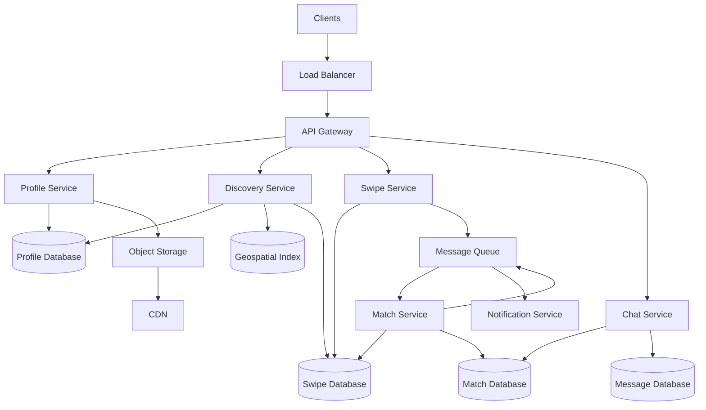

Tinder is a location-based dating application where users discover profiles, swipe right to like someone, or swipe left to skip. When two users like each other, the system creates a match and then lets them chat.

The main challenge is to show relevant nearby profiles quickly while handling a large number of swipes and making sure a match is created only when both the users have liked each other.

# REQUIREMENTS

## 1. FUNCTIONAL REQUIREMENTS

The system should allow a user to -

    1. Create and update a profile
    2. Upload and view profile photos
    3. Discover profiles based on the location and the preferences
    4. Swipe left to pass or swipe right to like a profile
    5. See a match when two users like each other
    6. Chat with matched users
    7. Block or report another user

## 2. NON-FUNCTIONAL REQUIREMENTS

The system should provide -

    1. Low latency when loading profiles and swiping
    2. High availability for profile discover and swiping
    3. Reliable match creation without duplicate matches
    4. Privacy controls for profile and location data
    5. Eventual consistency for some discovery updates
    6. Reliable message delivery for chats

A swipe should be saved reliably. If the other user has already swiped right, the system should create a match and notify both the users.

# THE BASIC DESIGN

The main components of our system can be -

    1. Load Balancer
    2. API Gateway
    3. Profile Service
    4. Discovery Service
    5. Swipe Service
    6. Match Service
    7. Chat Service
    8. Message Queue
    9. Databases
    10. Object Storage
    11. CDN

The basic flow can be like this -

    Client
    |
    Load Balancer
    |
    API Gateway
    |
    +--> Profile Service
    +--> Discovery Service
    +--> Swipe Service
    +--> Match Service
    +--> Chat Service

Profile photos can be uploaded directly to Object Storage. The CDN can serve those photos to other users.

# PROFILE DISCOVERY

When a user opens the app, the Discovery Service should return a batch of profiles that match the user's preferences. For example, the service may filter candidates by -

    1. Distance
    2. Age range
    3. Gender preferences
    4. Account status
    5. Profiles already seen or passed
    6. Block and safety rules

The service should not return every profile in the database and then filter them on the client side. It should retrieve a limited candidate set, rank it, and return a small batch.

    User opens discovery
            |
    Discovery Service reads preferences and location
            |
    Find nearby eligible candidates
            |
    Remove blocked and already-seen profiles
            |
    Rank candidates
            |
    Return a batch to the client

The client can request another batch when the current one is nearly finished. A cursor can help the service continue from where it left off.

## LOCATION SEARCH

The system can store user's latest approximate location and then user a geospatial index to find nearby candidates.

A common approach is to divide the map into cells and then the service can check the user's cell and the nearby cells. Then, it can calculate the actual distance for resulting candidates.

The cell lookup quickly narrows the search area. The distance check removes candidates who are outside the configured radius.

The system should use an appropriate location precision for discovery and avoid exposing a user's exact coordinates to other users. Location updates can also be rate-limited to reduce unnecessary writes.

# SWIPING AND MATCHING

When a user swipes on a profile -

    1. The client sends the target user's ID and the swipe action
    2. The Swipe Service stores the decision.
    3. If the action is a right swipe or a like, the service checks whether the target user has already liked this user.
    4. If both users liked each other, the system creates a match.
    5. A match event is published for notifications and chat setup.

    User A swipes right on User B
                |
        Store the swipe
                |
        Check whether B liked A
           /             \
         No                Yes
         |                  |
    Wait for B's swipe   Create a match
                            |
                  Notify both users

A swipe should be idempotent. This means, if the client retries the same request because of a timeout, the system should not create duplicate swipe records or matches.

A match can be stored with a canonical user order, such as the smaller user ID first. This makes it easier to enforce one match per pair.

For example, (user_12, user_45) represents the same pair regardless of which user swiped first.

Match creation should be protected by a unique constraint or equivalent atomic operation. This prevents two concurrent requests from creating duplicate matches.

# CHAT

Only matches users should be able to start a conversation with each other.

When a user sends a message - 

    1. The client sends the message to the Chat Service.
    2. The service verifies that the sender belongs to the match.
    3. The message is stored.
    4. The service delivers it to the other user, using a real-time connection when available.
    5. If the recipient is offline, the message remains available for the next sync.

The database is the durable record of messages. WebSockets or another persistent connection can deliver new messages with low latency, while push notifications can alert an offline user.

# DATA MODEL

We can roughly have these tables in our database.

A 'users' table stores the account information for each user -

    users
    -----
    user_id
    email
    account_status
    created_at

A 'profiles' table stores information shown during discovery -

    profiles
    --------
    user_id
    display_name
    birth_date
    bio
    gender
    preferences
    approximate_location
    updated_at

Profile photos can be stored as objects. A separate table can keep their metadata and display order -

    profile_photos
    --------------
    photo_id
    user_id
    object_key
    display_order
    status
    created_at

Note that the actual image files belong in Object Storage. The database stores their object keys and metadata only.

A 'swipes' table records each decision -

    swipes
    ------
    swiper_id
    target_id
    action
    created_at

In this case, the primary key can be -

  (swiper_id, target_id)

This prevents a user from creating multiple current swipe decisions for the same target. If the product allows the users to undo or change a swipe, the data model can also retain swipe history.

A 'matches' table stores the mutual likes -

    matches
    -------
    match_id
    user_low_id
    user_high_id
    created_at
    status

The pair (user_low_id, user_high_id) can have a unique constraint. The IDs are stored in a consistent order so the same pair cannot be inserted twice.

A messages table stores chat messages -

    messages
    --------
    message_id
    match_id
    sender_id
    message_content
    created_at
    delivery_status

An index on (match_id, created_id) helps fetch messages for a conversation in order.

# CACHING

The Discovery Service can cache recent candidate IDs for a user so it does not need to run a full candidate search for every profile card.

The cache should be invalidated or updated when relevant information changes like a new swipe, preference change, or a block. The server should still validate the candidate before returning it.

Profile details and photos are read frequently. They can be cached, while profile updates should invalidate or refresh the relevant cache entries.

# SCALING AND BOTTLENECKS

The system can scale by -

    1. Running multiple API Gateway and service instances
    2. Partitioning swipe data by swiper_id
    3. Partitioning messages by match_id
    4. Using a geospatial index for nearby profile lookup
    5. Caching profile data and discovery batches
    6. Using a message queue for match events and notifications
    7. Serving profile photos through a CDN

## 1. DISCOVERY LOAD

Problem: Finding and ranking nearby candidates can require many database lookups.

Solutions: Use geospatial index to narrow the search, cache candidate batches, and apply rankng to a manageable candidate set.

## 2. HOT USERS AND POPULAR AREAS

Problem: Some users or geographic areas may receive much more traffic than others.

Solution: The system can distribute data across partitions, cache frequently read profiles, and avoid making discovery depend on a single database shard.

## 3. SWIPE WRITE VOLUME

Problem: Swipes are frequent writes.

Solution: The system can partition swipe records by the user who made the swipe, which makes it efficient to retrieve that user's history and filter already-seen profiles.

The reciprocal-like check needs to find whether the target user liked the current user. The system can maintain a lookup index keyed by the target user and action, or use a data store that supports that access pattern.

## 4. MATCH RELIABILITY

Problem: The swipe write and match creation may involve separate services or databases.

Solution: A message queue can publish a 'SwipeCreated' event for match processing.

The match operation must be idempotent, and the unique constraint on the user pair prevents duplicate matches if an event if retried.

## 5. CHAT STORAGE AND DELIVERY

Problem: Messages should be stored durably before being acknowledged as sent.

Solution: Real-time delivery can happen asynchronously after storage. If the recipient is offline, the client can fetch messages when it reconnects.

# FINAL DESIGN

The Discovery Service finds and ranks eligible nearby profiles. The Swipe Service records each decision and checks for a reciprocal like. The Match Service creates one match per user pair, and matched users can then exchange messages through the Chat Service.

Geospatial indexing helps narrow candidate searches, while idempotent swipe and match operations keep retries from creating duplicate results.
